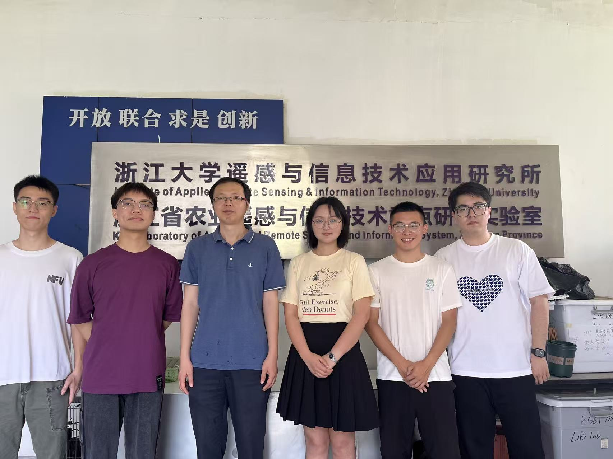

# Wang-Fumin-Official-Lab
Official website of Professor Fumin Wang’s research team at Zhejiang University, featuring research in environmental resource remote sensing, projects, publications, awards, books, patents, and software copyrights.
# Professor Fumin Wang’s Research Team

**Institute of Agricultural Remote Sensing and Information Technology, Zhejiang University**

Led by Professor Fumin Wang, our team conducts research in environmental resource remote sensing and its applications.

## Team Leader

**Professor Fumin Wang**  
Deputy Director, Institute of Agricultural Remote Sensing and Information Technology, Zhejiang University

Professor Wang has led nearly 20 research projects, including projects funded by the National Natural Science Foundation of China, subprojects of the National Key R&D Program and the National High-Technology Research and Development Program (863 Program), the Natural Science Foundation of Zhejiang Province, and the Doctoral Program Foundation.

He has published more than 80 academic papers and received multiple awards, including the Second and Third Prizes of the Zhejiang Science and Technology Award, the DBN Award, and the Second Prize of the Science and Technology Progress Award for Outstanding Scientific Research Achievements in Higher Institutions.

He has co-authored two books, *Experimental Research on Rice Hyperspectral Remote Sensing* and *Uncertainty in Rice Satellite Remote Sensing*. His team has also obtained six authorized patents and five software copyrights.

## Team Photo

